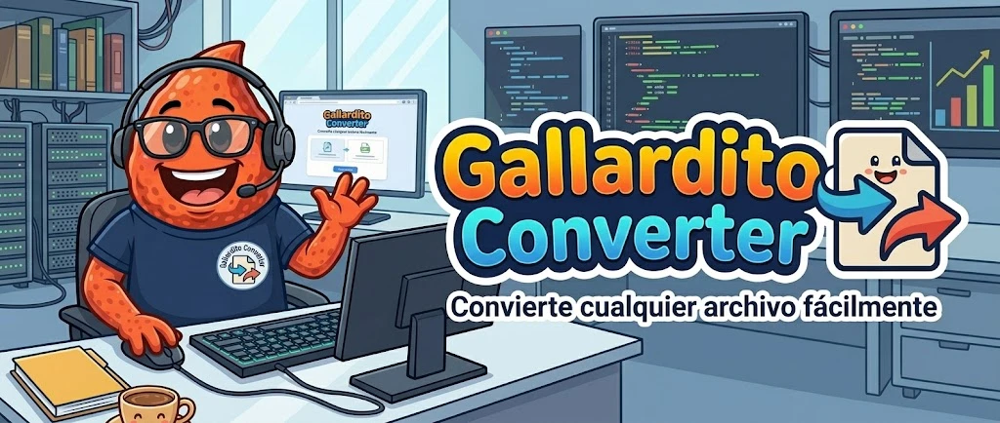

# Gallardito Converter

Convertidor de archivos web que funciona **en el navegador**: los archivos no se suben a ningún sitio. La única excepción es **DOCX → PDF/RTF**, que se hace con LibreOffice en nuestro propio servidor para conservar la maquetación (en RAM y borrado al instante).



## Formatos

| Entrada | Salidas |
| --- | --- |
| JPG | PNG · WEBP · GIF · BMP · PDF |
| PNG | JPG · WEBP · GIF · BMP · PDF |
| WEBP | JPG · PNG · GIF · BMP · PDF |
| GIF | JPG · PNG · WEBP · BMP · PDF |
| PDF | DOCX · TXT · HTML · JPG · PNG |
| DOCX | PDF · TXT · HTML · MD · RTF |
| TXT | PDF · DOCX · HTML · MD · RTF |
| XLSX / XLS | CSV · ODS · JSON · HTML · PDF |
| CSV / TSV | XLSX · ODS · JSON · HTML · PDF |
| MP3 | WAV · OGG · M4A · FLAC · OPUS |
| MP4 | WEBM · MOV · MKV · MP3 · GIF |

El archivo convertido se descarga con el mismo nombre y la nueva extensión. Si el resultado son varios archivos (un PDF de varias páginas pasado a imágenes, o un Excel con varias hojas pasado a CSV), se descarga un ZIP.

## Límites

- 10 archivos por tanda, 50 MB por archivo, 200 MB en total.
- Imágenes de hasta 50 megapíxeles.
- PDF a imágenes: hasta 100 páginas.
- Vídeo a GIF: primeros 20 segundos (10 fps, 480 px de ancho).

## Privacidad y legalidad (España)

- Casi todo se convierte en el dispositivo del usuario.
- DOCX → PDF/RTF: `public/api/convert.php` recibe el documento directamente en `/dev/shm` (RAM), lanza LibreOffice con un perfil temporal sin macros ni enlaces externos, devuelve el resultado y lo borra todo, también si falla. Una conversión a la vez, máximo 90 s.
- La página lleva una política de seguridad (CSP) con `connect-src 'self'`: el navegador bloquea cualquier envío de datos a otros dominios.
- Sin cookies, sin analítica y sin recursos de terceros (las tipografías van incluidas).
- El aviso legal, la política de privacidad y la de cookies están en `src/legal.js`. **Hay que rellenar los campos `[COMPLETAR]`** con los datos del titular (LSSI-CE art. 10).

## Desarrollo

```bash
npm install
npm run dev       # servidor de desarrollo
npm run build     # genera la web en dist/
npm run preview   # prueba la versión de producción
```

La carpeta `dist/` se puede copiar a cualquier servidor web estático y funciona en cualquier subcarpeta (las rutas son relativas).

### Requisitos del servidor

Apache con PHP 8 y LibreOffice sin interfaz, más fuentes compatibles con las de Office:

```bash
sudo apt install --no-install-recommends libreoffice-writer-nogui fonts-crosextra-carlito fonts-crosextra-caladea fonts-liberation fonts-dejavu fonts-noto-core
```

### Despliegue en el servidor del CIFP

```bash
npm run build
scp -i <clave> -r dist/* ubuntu@129.151.249.242:/var/www/html/TonyConverter/
```

Servidor: `https://myappsserver.duckdns.org/TonyConverter/`

## Software libre incluido

Todo se sirve desde nuestro propio dominio, sin llamadas a servicios externos:

- [LibreOffice](https://www.libreoffice.org) — DOCX a PDF/RTF en el servidor (MPL 2.0)
- [FFmpeg](https://ffmpeg.org) vía [ffmpeg.wasm](https://github.com/ffmpegwasm/ffmpeg.wasm) — audio y vídeo (GPL; código fuente en sus repositorios)
- [PDF.js](https://github.com/mozilla/pdf.js) — lectura de PDF (Apache 2.0)
- [pdf-lib](https://github.com/Hopding/pdf-lib) — creación de PDF (MIT)
- [SheetJS CE](https://sheetjs.com) — hojas de cálculo (Apache 2.0)
- [Mammoth](https://github.com/mwilliamson/mammoth.js) — lectura de DOCX (BSD-2)
- [JSZip](https://github.com/Stuk/jszip) — ZIP y DOCX (MIT)
- [gifenc](https://github.com/mattdesl/gifenc) — GIF (MIT)
- [Fredoka](https://fonts.google.com/specimen/Fredoka) — tipografía (OFL)

Los generadores de DOCX, RTF, Markdown, BMP y la maquetación de PDF son código propio (`src/lib/writers.js`).
